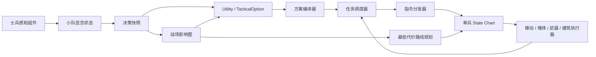
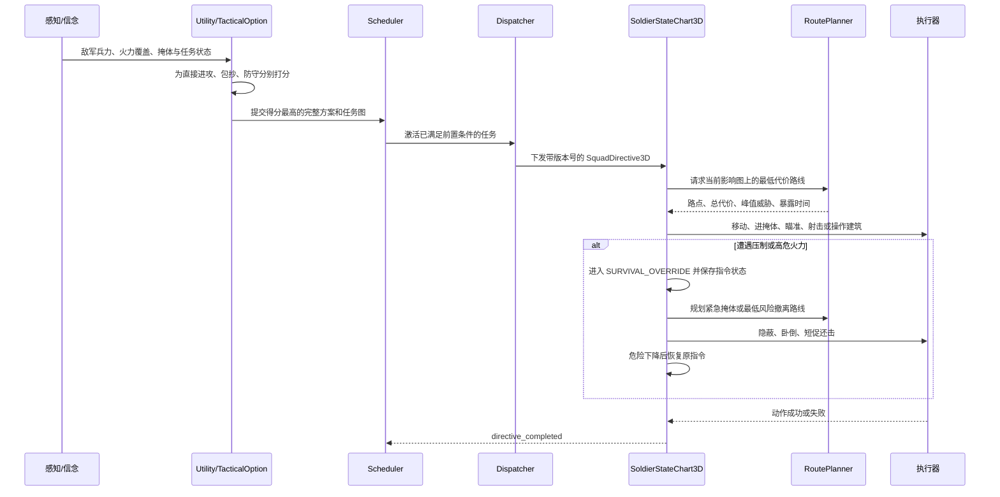
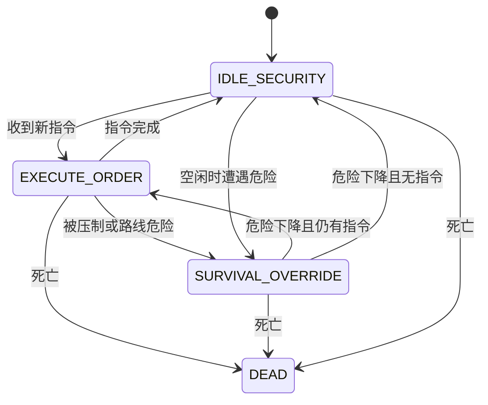

# 3D 战术 AI 模块流程

## 总体数据流

## 职责边界

| 模块 | 负责 | 不负责 |
| --- | --- | --- |
| 感知与信念 | 可见、声音、延迟报告、置信度和过期 | 直接选择战术 |
| 影响图 | 敌方火力叠加、压制、暴露、掩体、友军支援 | 发布士兵命令 |
| Utility / TacticalOption | 比较直接进攻、包抄、防守等完整方案 | 单兵逐帧移动 |
| 方案编译器 | 将方案拆为有依赖关系的任务 | 动画和射击时序 |
| Scheduler / Dispatcher | 任务生命周期、成员分配、生成 `SquadDirective3D` | 改写单兵安全规则 |
| 单兵 State Chart | 执行命令、生存打断、恢复命令、空闲警戒 | 改变全队战术目标 |
| 路线规划器 | 距离、峰值威胁、累计威胁、暴露时间和物理可达性 | 决定是否发动进攻 |

## 一次决策到执行

## 单兵 State Chart

`EXECUTE_ORDER` 内部按指令类型进入移动、占领掩体、攻击、压制、包抄、
侦察、固守、撤退或使用建筑。攻击由锁定目标、接敌、装填、瞄准、射击
组成；这些是明确转换，不再进行动作图搜索。

## 路线代价

路线不是单纯最短路。每条边的代价由移动距离加风险组成：敌军火力、压制
和暴露增加代价，掩体、隐蔽和友军支援降低代价；计划同时记录峰值威胁和
预计暴露时间。影响图版本变化且旧路线明显恶化时，单兵重新规划剩余路线。

## 失败与修复

任务有显式成功、失败和超时条件。`PLAN_REPAIR` 优先尝试换成员、换掩体、
换路线；只有修复无效或战场态势发生实质变化时，才重新选择整个战术方案。
单兵的生存打断不等同于任务失败，也不会错误发送完成信号。
