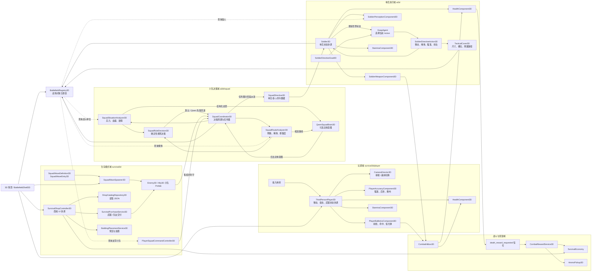
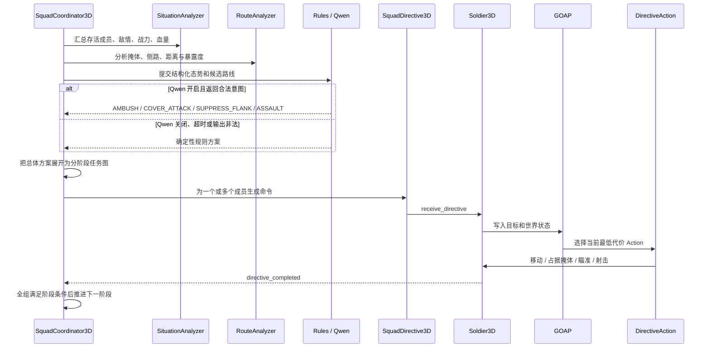

# 3D 程序模块调用流程

## 总体模块调用

实线表示命令或数据流；虚线表示只读查询。`ai3d` 不直接调用积分、商店或掉落物，死亡奖励通过信号跨域传递。

## 一次 AI 决策到执行

## 关键边界

| 模块 | 负责 | 不负责 |
| --- | --- | --- |
| `SquadCoordinator3D` | 决策周期、总体战术、分工和执行顺序 | 单帧移动、命中计算、积分发放 |
| `QwenSquadBrain3D` | 从结构化态势选择合法总体意图 | 直接控制士兵坐标或绕过 GOAP |
| `GoapAgent` + `SoldierDirectiveAction3D` | 为当前命令选择和执行动作 | 改变全队总体战术 |
| `BattlefieldRegistry3D` | 提供战斗单位、士兵、小队、掩体查询 | 战术判断 |
| `CombatRewardService3D` | 监听死亡信号并发积分、生成弹药 | AI 死亡逻辑 |
| `SurvivalShopController3D` | UI 状态与购买流程协调 | JSON 解析、具体生成、建筑几何放置 |
