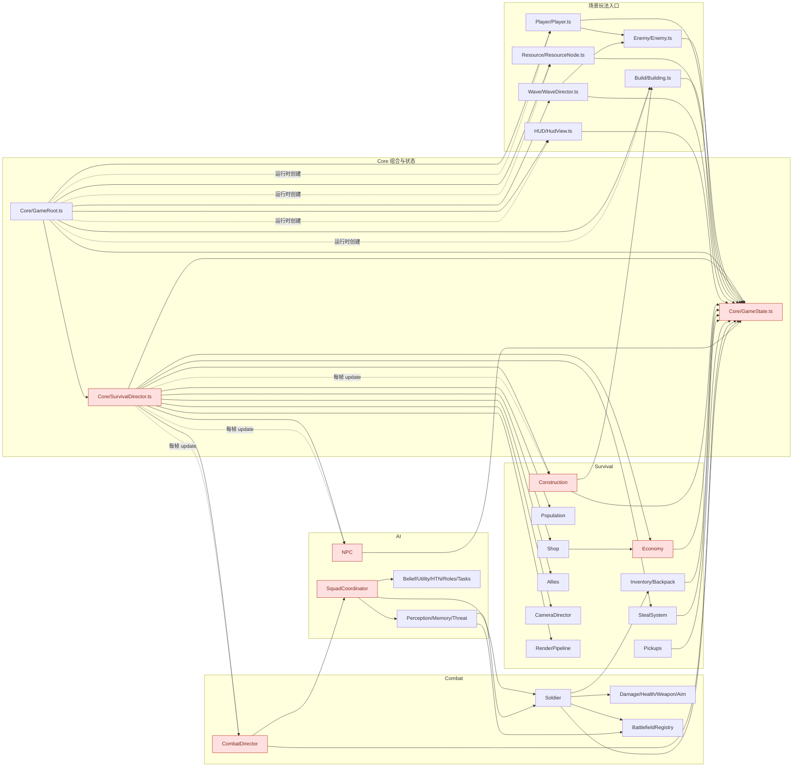

# 当前代码图

本文是当前 `assets/scripts` 的唯一引用关系图，不是目标架构。图中实线是生产脚本的静态 `import`，虚线是当前 `GameRoot`、`SurvivalDirector` 和 Playground 的运行时装配。`Tests/`、`Playtest/` 的 import 不计入静态生产依赖，但它们的装配关系列在表格中。

## 当前事实

| 范围 | 当前实现 |
|---|---|
| 主场景 | `Main.scene` 根节点挂 `GameRoot`；`GameRoot.buildArena()` 动态创建 Camera、Player、ResourceNode、Building、Canvas、HUD 和准星 |
| 生存/战斗/AI | `SurvivalDirector` 是第二个组合根，在 `onLoad()` 创建 Construction、Economy、NPC、Combat 等服务 |
| 玩家 | `Player` 是 Cocos Component，同时处理全局输入、移动、弹药扣除、最近敌人查找和攻击调用 |
| 士兵 | `Soldier` 是 Cocos Component，同时持有生命、武器、瞄准、伤口、压制、部位和背包状态 |
| Playground | `PlayerPlayground`、`CombatPlayground`、`BuildPlayground`、`AIPlayground` 都在 `onLoad()` 动态创建玩家、敌人或士兵 |
| 测试场景 | 5 个 `Tests/*.scene` 分别挂测试根脚本，测试主要通过 Cocos 预览执行 |
| 组件证据 | `.scene` 的自定义组件使用 Cocos 生成的类型 ID，不能仅凭 `.meta.uuid` 匹配；具体挂载关系应通过 MCP 场景层级查询确认 |

## 已知循环依赖

- `AI <-> Combat`：AI 直接依赖 `Soldier`/`BattlefieldRegistry`，Combat 直接依赖 `SquadCoordinator`。
- `Core <-> Survival`：`SurvivalDirector` 创建 Survival 服务，Survival 服务直接依赖 `GameState`。
- `Core <-> Combat`：`SurvivalDirector` 创建 `CombatDirector`，Combat 直接依赖 `GameState`。
- `Core <-> AI`：`SurvivalDirector` 创建 `NpcSystem`，`NPC` 直接依赖 `GameState`。

这些是当前代码事实，不是后续新增代码的允许依赖。重构时应通过 Application/Port 拆掉循环。
