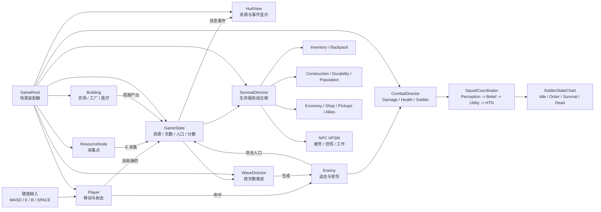
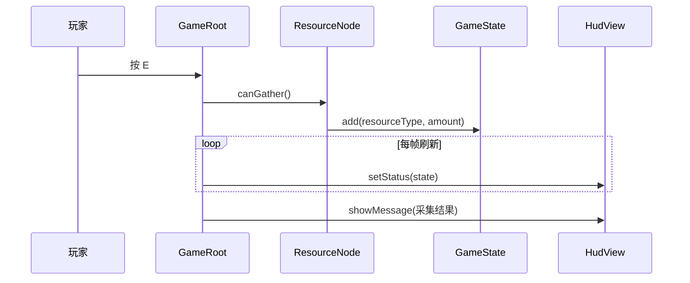
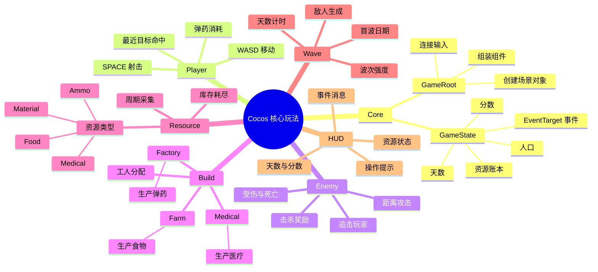

# Cocos 核心代码框架

这份文档描述 `cocos_project/assets/scripts` 的职责边界和数据流。代码按“谁负责什么”分组，避免把 Godot 原项目的场景、AI 和渲染依赖重新带入核心玩法。

## 代码框架图

### 一次完整交互

## 分类思维导图

## 依赖规则

1. `GameState` 是资源、人口、天数和分数的权威状态；资源、建筑和敌人不直接互相修改库存。
2. `Player`、`ResourceNode`、`Building`、`Enemy`、`WaveDirector` 属于玩法层，只依赖 `Core/GameState` 或自己的领域组件。
3. `HUD/HudView` 只读取状态并显示文字，不参与资源扣除、生产或伤害计算。
4. `Core/GameRoot` 可以依赖所有模块，因为它是启动场景的组装层；其他模块不应反向依赖 `GameRoot`。

## 扩展顺序

先在现有模块内补数值和测试，再增加 Prefab 与美术资源；新增系统时按同样规则创建目录，并通过 `GameState.events` 连接跨模块通知。复杂小队 AI、3D 模型和旧中世纪分支属于后续独立模块，不放回核心目录。
