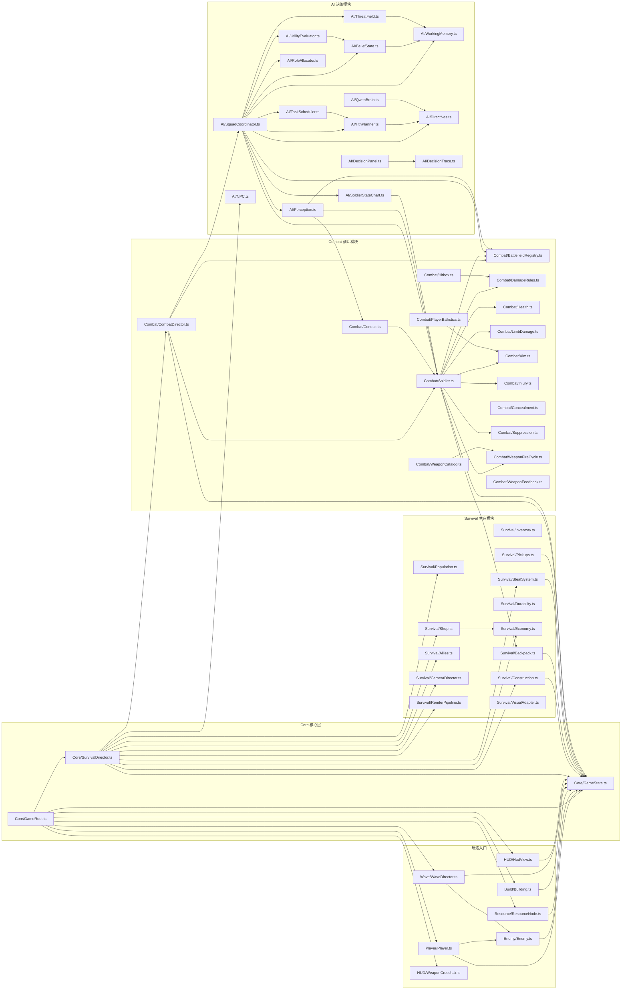
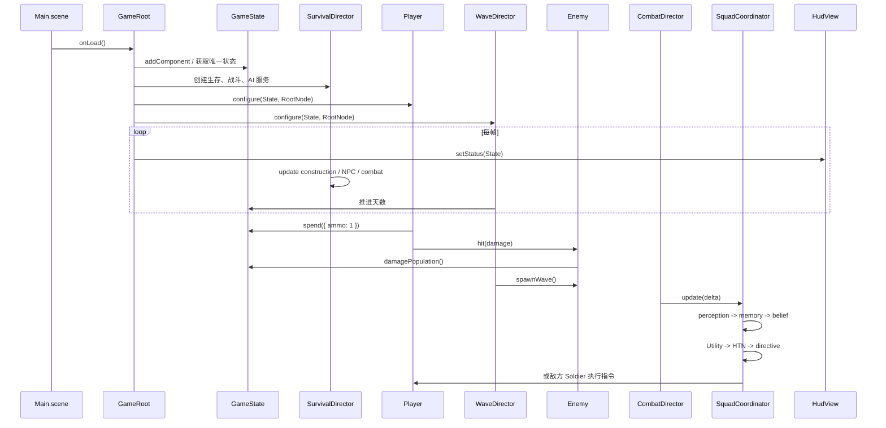
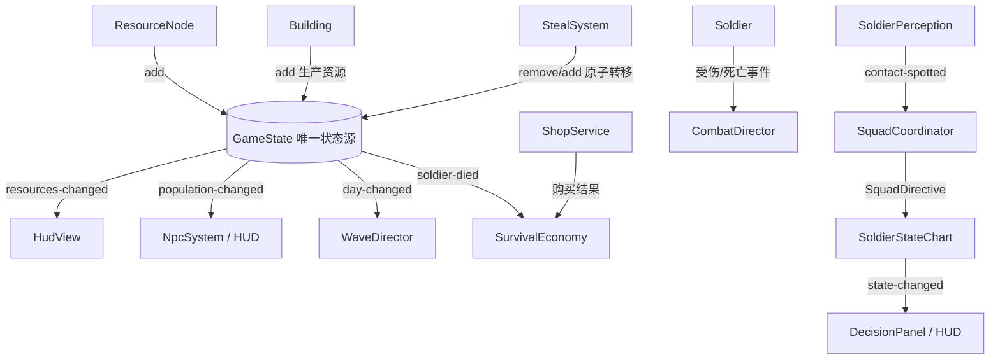

# Cocos 代码引用关系

图中箭头方向表示“左侧模块引用右侧模块”。例如 `GameRoot -> Player` 表示 `Core/GameRoot.ts` 通过 import 使用 `Player/Player.ts`。

## 1. TypeScript Import 关系

## 2. 运行时调用关系

## 3. 事件和数据所有权

## 4. 依赖边界

- `Core/GameState` 不依赖业务模块，是资源、人口、天数和分数的权威来源。
- `Core/GameRoot` 和 `Core/SurvivalDirector` 可以依赖所有模块，负责装配和驱动。
- `Player`、`Enemy`、`ResourceNode`、`Building`、`WaveDirector` 是场景玩法入口。
- `Survival` 负责经营系统；`Combat` 负责战斗规则和战斗实体；`AI` 负责感知、规划和指令。
- `HUD` 只能读取状态和事件，不应直接扣资源或修改敌人生命。
- `AI/QwenBrain` 只能生成经过白名单校验的 `SquadDirective`，不能直接访问场景或资源账本。
